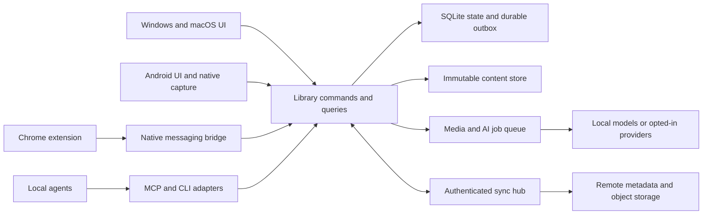

# Unified asset and knowledge library — project plan

Version 0.2 · 17 November 2026 · Planning baseline, not an implementation claim

Implementation update: a local reference prototype now exists. See [implementation status](IMPLEMENTATION_STATUS.md) and [ADR 001](ADR-001-REFERENCE-PROTOTYPE.md). The requirements below remain the target plan; the presence of prototype code does not imply R1 or M0 platform gates are complete.

Desktop delivery update: Atlas 0.2 packages that implementation with Electron and adds backups, bulk organization, previews and reviewed local AI suggestions. [ADR 002](ADR-002-DESKTOP-DELIVERY.md) supersedes the draft Tauri choice for this early desktop release. Native Android, synchronization and the full R1 acceptance suite remain pending.

## 1. Product decision

Build an independent, local-first application combining an Eagle-like asset library with Markdown notes, structured records, relationships, and built-in AI. Every item can be searched, tagged, linked, viewed in a collection, and accessed by authorized local agents.

Implementation may extend an existing open-source application. The [open-source evaluation](OPEN_SOURCE_OPTIONS.md) compares TagSpaces, SiYuan, AppFlowy and other foundations with reusable components. M0 selects a fork or composition route before committing to the stack. “Independent” describes our product and data ownership; it does not require writing every component ourselves.

The intended outcome is one durable personal library across **Windows, macOS, and Android**. Desktop provides dense organization and editing; Android provides capture, browsing, note editing, organization, and offline access. A Chrome desktop extension captures web material. Synchronization, history, and recovery are product capabilities rather than instructions to put a live database in a cloud folder.

### Confirmed requirements

| Decision | Baseline |
|---|---|
| Desktop platforms | Windows and macOS |
| Mobile platform | Android in the first usable cross-device release |
| Initial audience | One person using multiple devices; concurrent local agents are still possible |
| Reference | Eagle's asset workflows and information layout; independently implemented |
| Additional information | Markdown notes, links, graph views, typed relations, tables |
| AI | Built-in tagging, descriptions, categorization, retrieval, and controlled management |
| Automation | Built-in MCP, API, and CLI access for local agents and other tools |
| Extensions | Chrome capture extension included; third-party application plugin system deferred |
| Visual style | Minimal dark and light theme, opaque surfaces, basic borders, restrained accent |
| Deliverable now | Research-backed plan, scope, architecture, backlog, and validation gates |
| Reuse strategy | Prefer proven open-source foundations where adaptation and maintenance cost less than new implementation |

“Complete replica” is the long-term functional reference, not a promise that a first release can reproduce every third-party plugin or proprietary-format renderer. The backlog explicitly distinguishes the first cross-device release, subsequent parity work, and deferred capabilities. No required area is silently dropped because its implementation is difficult.

“Native” means built into the supported product. External AI providers, optional local model downloads, and internally bundled libraries remain compatible with this requirement. Users should not install plugins to get tagging, notes, graph, tables, MCP, or sync.

### Product boundaries

- Preserve original media; transformations create derivatives or explicit new versions.
- Local browsing, notes, tagging, and lexical search work without an account or model.
- Full library export works without a hosted subscription.
- AI cannot silently replace user-authored text, delete assets, or publish a collection under default settings.
- First release supports a single owner's devices. Team editing, comments/approvals, and role administration are later scope.
- Use our own name, icons, text, and implementation. Eagle is a workflow reference and migration source.

## 2. Research baseline

The companion [research document](RESEARCH.md) provides the source register and evidence limitations. Source IDs in this plan refer to that register. The official pages establish a substantial Eagle reference set; they do not establish tested parity.

The companion [open-source study](OPEN_SOURCE_OPTIONS.md) adds application candidates, component licenses, maintenance snapshots and measurable adoption gates. These are repository/documentation findings, not successful build or integration results.

| Reference area | What matters to this plan | Sources |
|---|---|---|
| Asset management | Capture, collections, tags, previews, filtering, metadata | E01, E11–E15 |
| Desktop interaction | Navigation/list/inspector, multiple layouts, quick actions | E02, E03, E20 |
| Browser capture | Single/batch collection, screenshots, capture-time metadata | E10 |
| AI and agents | Separate search, model setup, organization jobs, external agents | E05–E09, E16 |
| Plugins | Convert selected capabilities into built-in services | E04, E07, E08 |
| Sharing and migration | Whole-library and export formats; no assumed safe concurrent file merging | E17 |
| Future Eagle | V5 roadmap remains separate from current baseline | E18, E19 |
| Notes/graph/tables | Portable text, typed properties, linked information, multiple views | O01–O05 |
| Platform design | Native capture, durable queues, scoped file access, agent protocols | P01–P07, A01–A04 |

Research uncovered an important distinction: Eagle's AI Search launch describes natural-language matching against existing text metadata separately from visual similarity. Our product will distinguish those modes from actual vision-based content analysis. It will not label a filename search as image understanding. [E06]

The browser policy prevented fresh visual inspection. UI specifications below are proposed designs based on official descriptions; exact Eagle behavior needs an installed-app walkthrough during M0.

## 3. Core workflows

### Capture and organize

Save an image or selected text from Chrome, select a collection, optionally enter tags, and see it in Inbox. The original URL, page title, capture time, and selected excerpt remain attached. Duplicate detection offers reuse of an existing item, keeping new source/context information. Import returns quickly while previews and AI tasks run in the background.

### Research with notes

Create `Kitchen redesign.md`, embed reference images and a video timestamp, link related notes, and record suppliers in a table. The gallery, note, table, and graph refer to the same underlying items. Renaming a note or moving an item between collections does not break resolved relationships.

### Organize with AI

Select 200 untagged images and run a saved rule: suggest up to five tags from a vocabulary, add a factual description, and recommend existing collections. See the proposed changes, accept a batch or enable scoped automatic application, and inspect its history. A later correction is preserved when a job is rerun.

### Use a local agent

An agent searches the library, retrieves previews or note excerpts, creates a research note with source links, and proposes a set of changes. The same validation, revisions, and permissions used by the UI apply to the agent. The desktop window can be closed if the separately managed library service is running.

### Continue on Android

Share a photo, file, URL, or text from another app; add context immediately; continue offline. Metadata and selected originals synchronize later. A local model on a sleeping desktop is shown as unavailable; capture and editing still work, and AI processing can wait.

### Review and restore

Open History to see item changes and named checkpoints. Restore an earlier note or asset as a new revision, preserving later history. Conflicting offline edits appear in a review queue instead of being discarded.

## 4. Release model and feature catalog

**R1:** first dependable personal cross-device release, including Windows/macOS, Android, Chrome capture, basic notes/graph/tables, AI organization, agents, and sync.

**R2:** expanded Eagle workflow/format parity and deeper knowledge-management features.

**Later:** separately scoped capabilities with significant platform, format, collaboration, or product complexity. All first-release features must meet their acceptance criteria; a visual placeholder does not count.

The sortable [feature backlog](FEATURE_BACKLOG.csv) contains stable IDs, dependencies, and acceptance criteria. The following catalog explains the product scope.

### 4.1 Libraries and ingestion

| Capability | R1 | R2 / later |
|---|---|---|
| Libraries | Create/open/switch; local storage; schema version; storage usage | Multi-library search and library merge |
| Imports | Files/folders, drag/drop, paste, URLs, notes, CSV/JSON records | Additional importer presets |
| Watched folders | Copy-based import with debounce and durable queue on desktop | Advanced filters and scheduling |
| Identity | Stable item IDs; checksums; original filenames preserved | Cross-library deduplication |
| Duplicate handling | Exact-byte detection; reuse or keep separate logical items | Similar-image review and merge suggestions |
| Background processing | Persistent progress, cancel/retry, corrupt-file reporting | Configurable processing profiles |
| Capture Inbox | Unprocessed/untagged/unfiled views and review state | Advanced inbox automation |
| External files | Import managed copies; open/export through OS | Optional reference-in-place mode with broken-link repair |
| Migration | Eagle one-way import; normal folder and Markdown import | `.eaglepack` parser if validated; deeper Obsidian compatibility |
| Export | Originals, Markdown, metadata JSON, CSV tables, manifest | Custom export templates |

Do not delete originals from a watched folder by default. Do not let filesystem folder moves implicitly rewrite logical collection memberships. Interrupted imports must not leave a seemingly valid item pointing to an incomplete blob.

### 4.2 Organization and browsing

| Capability | R1 | R2 / later |
|---|---|---|
| Collections | Nested tree; an item in multiple collections without duplicate bytes | Covers, colors, saved ordering, advanced grouping |
| Tags | Create/rename/merge, groups, recent/favorite tags, bulk edits | Rich taxonomy aliases and translation assistance |
| Rule tagging | Explicit rules based on collection/type/source | More complex triggers and rule simulation |
| Metadata | Title, source, description, rating, dates, dimensions, MIME, size | Format-specific deep inspectors |
| Saved views | Filter/sort/columns persisted; smart collections | More predicates and cross-library scope |
| Layouts | Virtualized gallery and list; table for properties | Justified/waterfall, comparison and presentation views |
| Selection | Range/multi-select, keyboard navigation, bulk actions | Advanced selection presets |
| Preview | Spacebar desktop; tap mobile; zoom/pan; media controls | Pin windows, richer comparison and specialized viewers |
| Actions | Rename, tag, assign, trash, restore, export, open externally | Conversion, compression, crop and derivative tools |
| Recovery | Undo local edits; revision history; trash | More advanced bulk restoration tools |

Bulk editing must distinguish **add**, **remove**, and **replace**. Mixed values must never look like a shared value. Collection removal is not item deletion. Exact duplicate bytes and semantically similar images are different concepts.

### 4.3 File support contract

Every file can be stored, tagged, related, exported, and handed to another application if its size is within configured limits. “Supported” below means more than storage and must be validated by a per-platform fixture suite.

| Family | R1 preview/interaction | R2 / later | Important boundary |
|---|---|---|---|
| JPEG, PNG, WebP, GIF | Thumbnail, zoom, animation controls | Frame export and editing tools | Preserve animation and original color profile |
| SVG | Sanitized rendering; original download | Detailed vector inspection | Do not execute embedded scripts or fetch arbitrary resources |
| MP4, WebM, MOV and other video containers | MP4 H.264/AAC baseline; supported platform playback; posters and timestamps | Wider codecs, proxies, scrubbing strips, trimming | Container extension alone does not determine playback |
| MP3, WAV, M4A and other audio | Baseline playback where decoder exists, metadata | Waveform, transcription, wider codecs | Explicit unsupported-codec state |
| PDF | Page rendering, text search when text is extractable | Highlights, page anchors, richer annotation | Scanned pages need a separate OCR job |
| Markdown, TXT | Create/edit/preview, search, links, history | More authoring tools and formats | Markdown remains exportable as plain text |
| JSON, CSV, source code | Readable text; table import with schema mapping | Rich syntax modes and structured editors | Import does not execute scripts or formulas |
| HTML/bookmarks | URL card; captured readable text and screenshot where available | Sanitized offline page snapshots | No authenticated live browsing inside trusted app UI |
| Fonts: TTF/OTF | Metadata and OS opening | Built-in text specimens; optional desktop activation | Mobile font installation is outside R1 |
| HEIC, AVIF, TIFF, RAW | Store; preview only where validated decoder exists | Bundled converters and color-aware viewers | Platform/licensing/decoder differences |
| PSD, AI, EPS, Sketch, design files | Store, metadata, embedded preview if available | Dedicated thumbnail/preview adapters | No claim of full native editing |
| GLB/GLTF, OBJ, STL and other 3D | Store; generic file card | Sandboxed lightweight 3D viewer; material support | External textures must be packaged/resolved explicitly |
| EPUB, Office | Store, extract metadata if available, open externally | EPUB reader; Office conversion/previews | Complex rendering needs its own engine |
| Archives, SWF, other binaries | Store and export | Bounded archive listing; SWF separately evaluated | Never execute uploaded binaries |

Custom thumbnails are persistent user data; generated thumbnails and proxies are rebuildable derivatives. Do not purge custom covers as cache. Color palette extraction is R1; histogram, ICC-heavy workflows, and print-color fidelity are R2 validation work.

### 4.4 Markdown notes

R1 includes source editing with preview, autosave, headings, lists, checkboxes, code blocks, ordinary tables, links, attachments, simple templates, and backlinks. Notes can contain images, playable media links, PDF-page links, and item references. A compact outline and find-in-note support long documents.

Support ordinary Markdown links plus wiki-link input. Store resolved identity separately from the visible title/path so future renames do not depend only on textual matching. Preserve unresolved links and show them explicitly. Duplicate note titles require disambiguation. Export rewrites app references into portable relative paths where possible and reports references that cannot be represented.

YAML frontmatter supports common typed fields and a reserved namespaced identity field. Unknown user properties are preserved; invalid frontmatter produces a repairable error without destroying the body. External editor changes are supported through a reconciled working directory, as described in section 8.

R2 adds daily notes, richer templates, block references, PDF highlights, audio/video transcript links, a polished live-preview mode, optional math/diagrams, and more Obsidian import compatibility. R1 is not a full Obsidian clone and does not run Obsidian plugins.

### 4.5 Relations and graph

- All items—assets, notes, bookmarks, records—can be nodes.
- Explicit typed edges include `references`, `part_of`, `inspired_by`, `derived_from`, `related_to`, and user-defined types.
- Direction, source, target, creation provenance, and optional note are stored on each edge.
- Parsed note links create derived edges; typed relations are authoritative. Removing one must not accidentally remove the other.
- R1 local graph: one/two-hop neighborhood, filter by type/tag/collection, open node, create relation, and a text-list alternative.
- R1 bounded global overview: clustered/filtered with visible result limits; never load an entire huge library into a force simulation.
- R2: saved layouts, expanded graph filters, suggested relations, orphan review, stronger clustering, and canvas/mood-board view.

AI-suggested edges remain suggestions until accepted or allowed by an automation rule. Similarity is not a factual relationship. Trashed items remain resolvable in history but are hidden from ordinary graph queries.

### 4.6 Tables and structured records

R1 tables are saved views over items or independent records. A row has an item ID, optional Markdown body, and typed properties. An image can appear in both a gallery and a table without duplication.

Required property types: text, number, checkbox, date, date-time, URL, single-select, multi-select, and item relation. Required operations: add/edit/delete record, resize/reorder/hide columns, filter/sort, bulk edit, CSV import mapping, and CSV/JSON export. Records without an attached file are legitimate graph nodes.

Store a property's type once in a schema. Schema changes validate existing values and offer an explicit migration report. Keep null distinct from empty string, zero, and false. Dates without a time zone remain date-only; timestamps store UTC and display in the user's chosen zone.

R2 adds grouping, formulas, rollups, board views, calendar views, and richer templates. Formula evaluation must be deterministic and sandboxed; no arbitrary JavaScript or network access. This is not a spreadsheet calculation engine in R1.

## 5. Built-in AI and agent access

### 5.1 AI capabilities

| Function | R1 behavior | R2 expansion |
|---|---|---|
| Image understanding | Suggested description/title/tags; controlled taxonomy | Better batch evaluation and domain presets |
| Categorization | Recommend existing collections; optional scoped application | Proposed collection restructuring |
| OCR | Background extraction on selected images/scanned pages | Better layout handling and multilingual tuning |
| Search | Lexical + semantic text retrieval; local visual similarity | Cross-modal text-to-image retrieval once evaluated |
| Notes | Summarize selected sources with item/page/time citations | Deeper question answering and research synthesis |
| Tag cleanup | Propose aliases/merges, show affected item count | Assisted taxonomy governance |
| Relationships | Suggest connections with reasons | Larger-scale discovery and clustering |
| Automation | Manual run or on-import rule; queue/status/retry/cancel | Scheduling and multi-step workflows |
| Media editing | Preserve originals; not required for R1 | Background removal, upscale, erasing, conversion |

Provider setup is built in. R1 targets a local Ollama adapter and a configurable compatible HTTP provider; provider-native adapters can follow when needed. Discover vision, embedding, structured-output, and context-limit capabilities rather than assuming every selected model can do every task. Pin model/version and embedding-space metadata; do not compare vectors from incompatible models. [A03, A04]

Prefer local inference when configured. Cloud processing is opt-in per provider/library and shows what will be transmitted. A model download is explicit, with size and storage destination. Offline mode must never silently fall back to a remote service.

### 5.2 AI job contract

Each job records input item IDs and revision hashes, provider/model/version, prompt-template version, requested operation, scope, timestamps, status, and validated output. Job states: queued, running, proposed, applied, failed, canceled, or stale. Hashes and idempotency keys prevent duplicate application after retry.

Output must satisfy a schema, vocabulary, and permission checks. Syntactically valid JSON can still be wrong. Initial quality gates use a human-reviewed sample set, not a model's self-reported confidence. Default behavior is to add suggestions and preserve human fields. A user may explicitly enable automatic application for a bounded action such as adding tags to Inbox items; provenance and undo still apply.

Before applying a result, compare input revisions with current revisions. If the user changed a field while inference ran, preserve that change and mark the result stale or require review. Batch jobs are cancellable between items; canceling does not roll back already completed changes unless an explicit revert is requested.

Model-generated descriptions, OCR, and imported notes are untrusted content. They cannot authorize tools, change provider destinations, or select arbitrary filesystem paths. Limit model input/output size and rate/cost per batch. Never include secrets in prompts, exports, or ordinary logs.

### 5.3 MCP, HTTP API, and CLI

Use one library command/query layer behind every interface. MCP is a built-in adapter, not a special route around validation. Provide local stdio first and authenticated HTTP for deliberate remote use. Pin a supported MCP SDK/protocol set and test actual client versions; “MCP supported” does not mean compatibility with every historical client. [A01, A02]

Proposed tools:

| Group | Example tools | Required behavior |
|---|---|---|
| Discovery | `library_info`, `search_items`, `get_item`, `list_collections`, `list_tags` | Pagination, bounded fields, stable IDs, revision tokens |
| Content | `read_note`, `get_preview`, `get_asset_metadata`, `get_relations` | Bounded excerpts; originals only when scope allows |
| Capture | `import_file`, `capture_url`, `create_note`, `create_record` | Scoped file access, idempotency, source attribution |
| Organization | `update_properties`, `add_tags`, `remove_tags`, `assign_collection`, `link_items` | Typed commands and expected revision |
| Bulk changes | `plan_changes`, `apply_change_set`, `revert_change_set` | Reviewable diff, scope limits, no blanket auto-approval |
| AI | `analyze_items`, `suggest_tags`, `suggest_relations` | Returns a job or proposal; honors provider policy |
| History/sync | `get_history`, `get_job`, `get_sync_status`, `create_checkpoint` | Distinguishes local, uploaded, acknowledged, and failed |

R1 omits permanent purge and public-sharing tools. Agent identities have revocable grants: library/collection scope, readable content types, permitted operations, expiry, and batch size. A local process is not automatically trusted merely because it connects to loopback. External agents may receive durable user-approved scopes; ordinary safe operations inside those scopes need not prompt on every call.

CLI examples are product requirements, not existing commands: `library search`, `library import`, `library note create`, `library changes plan`, `library sync status`, and `library export`. Document installation/configuration for at least two real MCP clients during validation. Publish JSON schemas and example requests with the first release.

## 6. Desktop UI and interaction specification

### 6.1 Main application shell

```text
Library ▾     Search / command palette             Sync status   New +
┌──────────────────┬───────────────────────────────┬──────────────────┐
│ Inbox            │ Collection / saved view       │ Details          │
│ All items        │ Filters · Sort · View         │ Properties       │
│ Notes            │                               │ Relations        │
│ Collections      │ Gallery / list / table /      │ Source           │
│ Saved views      │ note / graph                  │ History          │
│ Tags             │                               │                  │
│ History          │ Selection and batch toolbar   │                  │
│ Trash            │                               │                  │
└──────────────────┴───────────────────────────────┴──────────────────┘
Jobs / import progress / AI proposals / transfer status
```

The desktop shell retains the useful Eagle navigation/content/inspector division. Notes, table, and graph are alternate views, not separate disconnected apps. Inspector panes can collapse. Search results can mix item types and explain whether a match came from a title, note, OCR, or semantic index.

### 6.2 Required screens and states

| Screen | Main behavior | States that must be designed |
|---|---|---|
| Library setup | Choose location; local-only or connect sync | No library, missing drive, insufficient space, newer schema |
| Inbox/gallery | Import, select, filter, inspect | Empty, importing, broken preview, offline original, partial results |
| Item preview | Media controls, metadata, relations | Unsupported codec, canceled download, missing original |
| Note editor | Write, embed, link, save | Saving, saved locally, sync pending, external edit, conflict |
| Table | Inline edits, columns, filters | Invalid type, mixed values, no rows, schema migration |
| Graph | Local neighborhood and bounded overview | Empty, truncated, loading, hidden/deleted target |
| Tag/collection manager | Create/rename/merge | Name collision, move cycle, bulk impact preview |
| AI jobs | Configure/run/review | Model unavailable, quota, invalid output, stale proposal |
| History/conflicts | Inspect diff, resolve, restore | Binary alternatives, missing historical blob, stale resolution |
| Devices/sync | Pair, pin offline, retry | Connecting, paused, uploading, conflict, revoked device |
| Settings | Models, storage, agents, backups, shortcuts | Connection test, permission denied, cache limits |

### 6.3 Visual direction

Proposed tokens: canvas `#111315`, panels `#191C20`, elevated surface `#22262B`, borders `#343A42`, primary text `#F1F3F5`, muted text `#A9B1BA`, accent `#7CA7FF`. These are starting values; test contrast in actual components.

Use a system sans-serif font, 4/8-pixel spacing rhythm, roughly 6-pixel corner radius, clear selection borders, and restrained transitions. Avoid glass, decorative gradients, glows, large shadows, ornamental illustrations, and unnecessary animation. Content thumbnails provide visual richness.

Desktop starting sizes: 220–260 px navigation, flexible content, 280–340 px inspector; user-resizable and collapsible. These are our starting measurements, not measurements of Eagle. Preserve workable layouts at 1280 px and with enlarged text.

Keyboard baseline: arrows to navigate, Shift for ranges, Space to preview, Escape to close transient UI, Ctrl/Cmd+K for commands, and platform-appropriate undo/find. Actions must be available through visible controls, not exclusively through hidden gestures. Screen readers need named buttons, selection state, focus management, and a relationship-list alternative to graph visualization.

## 7. Android product scope

Android is a real offline-capable application in R1, not only a browser link. Proposed minimum Android version: Android 10, subject to M0 dependency checks; target the current required SDK at release. Validate on at least one midrange phone and one newer device.

### Navigation and functionality

Bottom navigation: Library, Search, Capture, Notes, More. Collections open in a drawer/screen; Details opens as a sheet; tablets may use two panes. Touch targets should be at least 48 dp. Long-press enables selection, but visible action menus remain available. Do not rely on hover, tiny inspector controls, or desktop drag gestures.

R1 includes gallery/list, filters, quick preview/playback, tag/collection edits, note writing, basic record forms/table viewing, local graph, search, offline pinning, jobs, and sync status. A graph defaults to a selected item's neighborhood; the global graph is bounded. Editing table schemas on a phone is simplified rather than requiring desktop-sized spreadsheets.

### Capture and storage

- Receive URLs, selected text, one/multiple images, video, and generic files through Android share intents. [P01]
- Import through the system photo/document pickers. Handle content URIs rather than assuming desktop file paths. [P03]
- Copy accepted shared bytes into app-controlled staging before temporary URI access expires; retain only appropriate persistable grants.
- Persist capture drafts before navigating away. A killed process must not lose acknowledged captures.
- Store metadata and thumbnails locally; pin originals per item or collection; enforce a configurable cache budget.
- Use native background scheduling, connectivity constraints, retries, and user-visible progress for long transfers. Android scheduling is opportunistic; do not promise an always-running desktop-style daemon. [P02]
- No automatic mirroring of the entire photo library in R1. Imported content must be chosen by the user or an explicit capture rule.

Heavy inference/format conversion can run on a paired desktop or self-hosted worker. A disconnected worker leaves a durable queued job. On-device OCR or lightweight models are optional later improvements, not prerequisites for Android capture.

## 8. Data model, library format, and portability

### 8.1 Shared entities

| Entity | Essential fields / responsibilities |
|---|---|
| Library | ID, schema version, owner, settings, device roster |
| Item | Stable ID, kind, title, MIME, dates, revision, trash state |
| AssetVersion | Item ID, content hash, byte size, original filename, metadata, predecessor |
| NoteRevision | Item ID, UTF-8 body hash, frontmatter, predecessor |
| Collection | ID, parent, name, display settings; cycle checks |
| Membership | Collection/item pair with versioned add/remove operations |
| Tag / TagGroup | IDs, labels, aliases, group membership |
| PropertySchema / Value | Stable property ID, type, scope, validated value |
| Relation | Source/target IDs, type, provenance, annotation |
| SavedView | Query/filter AST, layout, sort, columns, scope |
| Annotation | Item/version anchor, page/time/region, body, revision |
| ChangeSet / Operation | Actor, device, base revision, idempotency key, typed changes |
| Job / Proposal | Input revisions, task/model metadata, outputs, application status |
| Blob / Derivative | Hash, location, retention, parent version, generator version |

Stable UUID-style identifiers are independent of filename and path. Folders are logical collections. Content hashes identify bytes, not user intent: identical bytes may belong to distinct logical records sharing one stored blob.

### 8.2 Proposed on-disk layout

```text
My Library/
  library.json                 # ID and schema; no credentials
  data/library.sqlite          # transactional records, revisions and outbox
  objects/sha256/ab/<hash>      # immutable originals and committed note bodies
  notes/Projects/Research.md   # readable, reconciled working files
  manifests/                  # portable metadata snapshots
  cache/thumbnails/           # generated and disposable
  cache/previews/             # generated and disposable
  staging/                    # incomplete imports/transfers
  exports/                    # user-created exports, never treated as cache
```

This is a proposed new format, not Eagle's `.library` schema. Android uses its storage model internally while exporting the same portable package.

SQLite holds committed structured state, revisions, and the durable operation outbox. Immutable blobs hold committed content. Markdown files are a user-editable working projection, not an independent second database. This explicit choice prevents conflicting authoritative copies.

### 8.3 External Markdown edits and crash recovery

1. UI changes are committed to the database plus blob store, with a pending file-write record.
2. A writer updates the `.md` working file using a same-directory temporary file and atomic replacement where supported.
3. A watcher detects changes from other editors, waits for writes to settle, and compares the current hash to the last materialized hash.
4. An external edit becomes a normal revision through the command layer. Concurrent changes use the note conflict policy, not blind replacement.
5. On restart, recover pending writes and scan modified files before overwriting any projection. Preserve divergent disk text as a conflict revision.

Renaming files externally preserves IDs from frontmatter when present. Duplicating a file with the same reserved ID is detected and resolved into a new item or explicit conflict. Maintain a link-resolution index; do not globally rewrite arbitrary text with filename replacements.

A valid backup includes a consistent database snapshot, referenced blobs, unapplied external Markdown changes, and the pending outbox. A checkpoint records a manifest and blob availability. Generated indexes and thumbnails can be rebuilt. A restore test must prove that unsynchronized changes and relations survive, not merely that image files reappear.

### 8.4 Migration and export

Eagle migration is one-way into a new library. Prefer the documented API while Eagle is running; a read-only copied-library parser may support offline import after its schema is validated. Do not edit the source library or assume undocumented structures are stable. [E11, E16]

Map original files, names, tags/groups, collection memberships, ratings, source URLs, descriptions, dates, custom thumbnails, and annotations. Preserve original Eagle IDs in a migration namespace. Translate supported smart rules and report unsupported ones. Keep a migration ledger and hashes so retries do not duplicate content. Produce counts for imported/skipped/failed/unmapped items and verify samples.

Markdown imports preserve raw files and unknown frontmatter. Table import requires explicit type mapping; reject ambiguous coercions. Export includes a manifest, originals, notes, metadata, relations, and table schemas/values. CSV is convenient but cannot represent the entire library; JSON/package export is the lossless path.

Optional Git export contains readable Markdown, metadata manifests, and small preview references. Git is not the live library synchronization engine, and large binaries remain in media storage or an explicitly configured LFS workflow. [P08]

## 9. Synchronization, history, and sharing

### 9.1 Transport and topology

Start with one trusted sync hub reachable by all paired devices. It can run on a user's desktop for LAN/VPN access or on an always-on self-hosted machine. The latter allows a phone to sync while the desktop is asleep. Provide a documented single-user server deployment; managed hosting is a later commercial/product decision.

Use HTTPS authenticated requests, paginated change feeds, per-device cursors, retryable blob uploads, and immutable content addressing. The hub assigns canonical library sequence numbers and validates commands. Offline clients keep local durable commands and base revisions; wall-clock timestamps are display metadata, not conflict authority.

Separate metadata synchronization from original downloads. Mark a revision available only once its referenced content is verified at the receiving service; placeholders explicitly show queued or unavailable media. Pause/retry/limit transfers, and prefer Wi-Fi on Android by default for large files.

Never synchronize an open SQLite file through Dropbox/Drive. Those services may receive closed backup/export packages, not act as an uncoordinated second writer.

### 9.2 Conflict policy

| Concurrent change | R1 resolution |
|---|---|
| Different scalar fields | Apply independently with field revisions |
| Same title/description/property | Keep both values in a conflict; require explicit resolution |
| Tag or collection membership | Versioned set operations; deterministic observed-add/remove semantics |
| Markdown edits | Three-way merge from common revision when unambiguous; otherwise keep both texts |
| Original media replacement | Preserve both immutable versions; select the active one explicitly |
| Item deletion versus edit | Soft-delete conflict with recoverable edited version; no automatic purge |
| Concurrent collection moves | Validate against latest tree; prevent cycles; conflict if intent cannot be preserved |
| Tag merge versus stale tag assignment | Resolve alias/redirect to surviving tag ID; retain merge history |
| Schema/type changes | Reject incompatible stale writes with actionable migration/conflict details |
| Stale AI or agent proposal | Revalidate expected revision and scope; no silent overwrite |

An agent and a user on the same computer can conflict even in a personal product. One local writer/transaction boundary serializes operations; expected revisions detect stale intent. Retried operations have exactly-once effects through deduplication, although network delivery itself is at-least-once.

### 9.3 History and retention

Record who/what changed each item: user, device, agent, rule, or model job. Support item history, change-set history, named checkpoints, restore-as-new-revision, and batch undo. Do not confuse an activity log with recoverable content history.

Define retention before release: soft-deleted items and replaced blobs remain recoverable for the configured period. Garbage collection checks live references, retained revisions/checkpoints, and device acknowledgments. Devices offline beyond the tombstone-retention window must rebase through a full snapshot instead of resurrecting deleted records. Backup snapshots and version history are separate mechanisms.

### 9.4 Sharing and security boundary

R1 supports own-device access and exportable collections. R2 adds revocable read-only gallery links with expiry, a scoped item set, optional downloads, and private thumbnails. Publishing is explicit; adding an item to a private collection must not silently expand a published share.

Initial self-hosted sync trusts the user's server operator. Use TLS, protected server storage/backups, device revocation, and OS credential stores. This is **not** a claim of end-to-end encryption. If untrusted hosted storage or zero-knowledge hosting becomes a launch requirement, E2EE and key recovery become a prerequisite workstream; remote AI and server-side previews must then be redesigned around decrypted client/authorized-worker access.

## 10. Chrome extension

Implement a desktop Manifest V3 extension with a durable queue. A registered native messaging bridge connects to the installed desktop service. Large media must stream/chunk through a bounded transfer path rather than being placed in one huge JSON message. Persist pending captures because extension workers can stop. [P04, P05]

R1 scope:

- Save current image/link/selected text or page bookmark from the context menu.
- Select multiple page images with size/type filters and deduplication.
- Choose collection/tags and optionally add a short note before save.
- Capture visible region/selected area; include page URL/title/time.
- Show pending/success/failure states when the app/service is unavailable.
- Explicitly request only permissions required by enabled capture modes.
- Confirm ingestion acknowledgments using capture IDs so retry does not create duplicates.

R2: element/full-page capture with sticky-element handling, higher-resolution source selection, richer readable-article extraction, and Edge/Firefox packaging. Safari is a separate later integration. Dynamic, protected, canvas-based, and cross-origin content may need fallbacks; no promise to bypass authentication or copy every web resource.

Browser-provided bytes and URLs are untrusted. Validate sender, MIME, size, and destination; sandbox previewed web content. URL-fetch workers block inappropriate local-network targets unless the user has explicitly configured that source. Do not make a global unauthenticated loopback API the extension bridge.

## 11. Proposed architecture and stack decision



The diagram represents shared contracts and reusable code. Each device has its own local library instance; it does not mean all devices write one SQLite file. Android invokes the core in-process with native lifecycle integration; desktop can use a background service. The sync hub is a separate process.

### Component-based stack option, conditional on M0

This table and the detailed storage/sync design above describe the composition route. They are not mandatory internals for an open-source fork. A selected fork should preserve its tested engine and sync implementation when they meet our acceptance criteria. M0 must revise this section, storage ownership and milestone estimates together if it chooses another foundation. Do not introduce a second authoritative database merely to preserve this draft architecture.

| Layer | Proposed choice | Rationale / gate |
|---|---|---|
| Desktop shell | Tauri 2 | Small shell and Rust integration; test video, drag/drop, windows, signing |
| UI | React + TypeScript | Shared components, virtualized lists/tables, editor ecosystem |
| Core | Rust library | Shared validation, hashing, storage, sync, import contracts |
| Android | Tauri mobile + Kotlin bridges | Reuse UI/core; prove share intents, storage, background scheduling early |
| Fallback Android UI | Kotlin/Compose over same core/API | Use if WebView editor/media/accessibility fails the prototype gates |
| Local database | SQLite + FTS5 | Transactions, relational queries, offline full-text search [P07] |
| Note editor | CodeMirror-style Markdown editor | Source fidelity and incremental editing; library/version selected during spike |
| Graph | Canvas/WebGL renderer with bounded graph queries | Avoid DOM nodes for large graphs; evaluate keyboard accessibility |
| Media processing | Isolated native workers; FFmpeg/PDF/image libraries as applicable | Capability/license review; Android uses native decoders where suitable |
| Semantic index | Versioned local embedding index behind an interface | Benchmark memory/retrieval first; no distributed vector service required |
| AI adapters | Built-in Ollama + compatible HTTP adapter | Local and optional remote inference without a marketplace |
| MCP adapter | Supported SDK with schema-generated tool contracts | stdio and authenticated HTTP; real-client compatibility tests |
| Sync hub | Small Rust service; PostgreSQL for server metadata; S3-compatible blobs | Clear transaction and media boundaries; local disk blob adapter for simple self-hosting |

Tauri documents mobile/native bridges, but that does not prove the full Android experience. [P06] M0 compares the proposed shell with a native Android fallback. Electron remains a desktop fallback if required media/native integrations prove materially harder; it does not solve Android by itself. Avoid starting with two unrelated data engines.

Do not select package versions or AI models solely from this document. Verify current maintenance, licenses, platform support, and benchmark results when implementation begins.

Prioritize existing editor, table, graph, PDF, media, OCR and protocol libraries from the [component shortlist](OPEN_SOURCE_OPTIONS.md#3-reusable-building-blocks). Test TagSpaces as the asset-first fork and SiYuan as the knowledge-first fork; AppFlowy is a substitute when mobile/editor constraints justify it. Proprietary Pro modules and paid service features are not automatically included in open-source reuse. No candidate code has been copied into this project.

### Suggested repository layout

```text
apps/desktop/        apps/android/        apps/browser-extension/
apps/sync-server/    apps/mcp-server/     apps/cli/
packages/ui/         packages/contracts/  packages/editor/
crates/library-core/ crates/storage/      crates/sync/
crates/importers/    crates/media/        crates/automation/
fixtures/            tests/               docs/
```

This is a proposed layout. Only planning documents exist at this stage.

## 12. Nonfunctional requirements

The following are initial acceptance targets, not measured results. M0 establishes hardware, datasets, and measurement procedures before finalizing budgets.

| Area | Initial target |
|---|---|
| Baseline desktop dataset | 50,000 items with mixed metadata; 10,000 notes; 100,000 relations |
| Desktop hardware profile | Representative 16 GB RAM SSD machine; separate Windows/macOS results |
| Warm lexical search | p95 below 300 ms excluding rendering and uncached media downloads |
| Initial usable library shell | Under 3 s on baseline desktop with existing indexes |
| Scrolling | Virtualized rendering; target smooth 60 Hz interaction without decoding every original |
| Large imports | Stream bytes and bounded workers; show progress without holding full files in RAM |
| Android baseline | 10,000 metadata records and 1,000 cached thumbnails on a 6 GB RAM phone |
| Android memory | Initial target under 300 MB for ordinary browsing; measure peaks during media playback |
| Local edit durability | Acknowledged edits survive forced process termination |
| Sync convergence | All connected clients reach identical accepted revisions after retries/reordering |
| Recovery | Restore on a clean device and verify referenced content hashes and record counts |
| Accessibility | Keyboard-complete core desktop workflows, visible focus, contrast checks, Android screen-reader pass |
| AI quality | Evaluate on at least 100 representative items; agree acceptable precision/correction rate before auto-apply |
| Security | Scoped agent access; no credentials in logs/exports; sanitized previews; signed releases |

Record semantic-search performance separately from lexical search. On-device model loading, first indexing, and network inference must not be hidden in a misleading response-time claim. Device storage use must explain originals, cached previews, history, model weights, and pending transfers separately.

## 13. Milestones and dependency order

Indicative elapsed ranges assume two experienced full-time engineers with part-time design/QA help, reuse of mature libraries, and access to Windows/macOS/Android test devices. They are planning estimates, not a fixed quote. M0 must recalibrate them. Including the foundation evaluation, summed sequential ranges suggest roughly **25–37 weeks for R1 on the composition route**, with substantial uncertainty; a solo build may take longer. A successful fork can reduce later work, but no reduction is claimed before measuring adaptation, integration and maintenance. Broad format parity and later capabilities are additional work.

| Milestone | Indicative duration | Concrete deliverable | Exit gate |
|---|---|---|---|
| M0 — Foundation, architecture and evidence | 3–4 weeks | Open-source build/license screening, at most two executable routes, Eagle walkthrough, schema examples, Android capture and sync experiments | Fork/composition decision backed by platform and integrity tests; no unresolved licensing or data-loss dependency |
| M1 — Durable local library | 4–6 weeks | Import/store/query/tag/collections; original export; history; minimal desktop UI; Android core scaffold | Restart/crash/import recovery and migration fixture tests pass |
| M2 — Notes and relationships | 4–6 weeks | Markdown editor, external-change reconciliation, typed properties, table, links/backlinks, local/bounded graph | Rename/external edit/export round trip; tables and graph reference same IDs |
| M3 — Cross-device and capture | 5–7 weeks | Sync hub, conflict UI, Android offline app, Chrome extension, checkpoint backup | Windows/macOS/Android round trip survives offline conflicts and interrupted transfers |
| M4 — Native AI and agents | 4–6 weeks | Provider settings, OCR/semantic jobs, tagging, proposals, MCP/API/CLI, audit/undo | Real model and agent workflows work within scopes; stale writes and retries tested |
| M5 — R1 hardening and release | 5–8 weeks | Installer/signing, update strategy, Android package, accessibility, import/export guide, recovery docs | Release acceptance suite passes on all target platforms |

M0 deliberately includes Android and agent contracts. M1 includes revisions/outbox even before remote sync. M2 includes stable relations before the graph renderer. This avoids discovering late that the core cannot represent mobile or agent edits.

R2 workstreams: expanded layout/preview parity; similar-image tools; advanced note authoring; formulas/rollups; read-only web galleries; additional browsers; specialized file renderers; native image transformations. Estimate each after R1 metrics and fixture results. Team collaboration, full plugin compatibility, iOS, broad desktop Linux certification, zero-knowledge hosting, and full creative-file editing remain separately scoped.

## 14. First implementation sprint

The next step after this plan is M0, not a polished gallery with placeholder data.

| Task | Output | Completion evidence |
|---|---|---|
| Product fixture definition | Small mixed library of consented/test assets and notes | Expected metadata, tags, relationships and hashes listed |
| Open-source screening | TagSpaces/SiYuan source and license boundary review; AppFlowy substitute if justified | Pinned revisions, required paid modules identified, target-platform build paths documented |
| Foundation comparison | At most two executable routes against the same fixture | Asset/note/Android/sync/agent gates, adaptation effort and upstream maintenance cost recorded |
| Eagle baseline walkthrough | Screen/interaction inventory and import mapping | Version recorded; uncertain requirements resolved or labeled |
| Entity/command schema | Item, revision, relation, property, operation contracts | Examples for UI, agent, sync and import use the same IDs |
| Atomic import experiment | One original imported, preview generated, restart recovered | Corrupt/truncated input and forced termination covered |
| Android experiment | Share image/text/video; edit note offline | Survives process death and temporary URI expiration |
| Desktop shell experiment | Windows/macOS grid, keyboard preview, local file access | Real files and video, not just static UI |
| Sync conflict experiment | Two offline replicas and retryable commands | Same-field, set-membership, note, delete/edit outcomes verified |
| Markdown experiment | UI edit plus external edit and rename | No silent overwrite; export opens in a normal text editor |
| MCP experiment | One read and one scoped reversible write | Tested through an actual client; unauthorized write rejected |
| Decision record | Chosen fork or composition route, shell, sync semantics, storage ownership | Alternatives, licenses, measured limitations and revised milestone estimates recorded |

M0 is allowed to replace a proposed library/framework if a test fails. It is not allowed to weaken data integrity or remove Android support without an explicit scope revision.

The first five engineer-days screen source, build and license viability; then narrow to at most two executable routes. The full comparison rubric and stop conditions are in [Open-source options](OPEN_SOURCE_OPTIONS.md#4-fork-versus-composition-evaluation). Reusing an upstream implementation counts toward a feature only when its corresponding acceptance criteria pass.

## 15. Release acceptance scenarios

1. Import mixed images, GIF, playable/unsupported-codec video, PDF, Markdown, CSV, and unknown binary. Originals export with matching hashes; unsupported previews are clear.
2. Add one asset to two collections. Remove one membership and confirm the other and the bytes remain intact.
3. Edit tags/ratings/properties in bulk. Mixed values and add/remove/replace behavior are accurate; undo restores the prior state.
4. Rename a linked note and reorganize collections. Backlinks, graph edges, table relations, and exported links remain valid.
5. Edit a note externally while the application is closed, then reopen. Import changes before writing any stale projection.
6. Edit the same note independently on two devices. Merge disjoint edits; preserve overlapping alternatives with a usable conflict screen.
7. Replace a video on desktop while Android edits its description. Preserve both intents and all retained media versions.
8. Share an image and URL into Android while offline; kill/restart the app. Accepted captures and notes remain available and sync later.
9. Interrupt a large upload, resume it, replay requests, and verify exactly one logical import with correct bytes.
10. Delete an item on one device while another edits it offline. No silent loss or unexplained resurrection.
11. Run AI tagging with a bounded vocabulary. Review source/provenance, preserve a manually corrected tag, and undo the applied batch.
12. Disable network access. Local organization and lexical search still work; cloud AI remains queued/unavailable without fallback disclosure failures.
13. Let an MCP client read one collection and propose an edit. It cannot read another scope, purge files, or bypass expected revisions.
14. Capture from Chrome with the desktop service unavailable. Queue status is truthful and later acknowledgment does not duplicate items.
15. Restore a backup on a clean installation. Notes, originals, property schemas, relations, pending work and retained versions match the manifest.
16. Import a representative Eagle library twice. The second run resumes/reconciles rather than duplicating everything; unmapped fields are reported.
17. Browse/search the baseline performance dataset on every target platform. Record hardware, cold/warm state, latency, and peak memory.
18. Complete capture → note → link → search → export using keyboard on desktop and screen-reader-supported controls on Android.

## 16. Risks and responses

| Risk | Response / release implication |
|---|---|
| Scope becomes several mature applications at once | R1 contract plus explicit R2/Later backlog; no claim of total parity |
| Sync silently loses data | Typed operations, revisions, conflicts, immutable versions, adversarial replay tests |
| Markdown and database disagree | One committed authority with reconciled working files and recovery journal |
| Android background limits | Native scheduling and durable queues; communicate pending state |
| WebView/media differences | Test actual platforms in M0; fallback native surfaces for failed capabilities |
| Huge video/history costs | Selective sync, resumable transfer, clear retention and usage reporting |
| AI invents metadata or restructures incorrectly | Proposals, constrained schemas, provenance, evaluation, reversible scoped application |
| Agent/prompt injection | Treat content as data; service-enforced scopes; no arbitrary shell execution |
| Format and codec dependencies | Publish capability matrix; sandbox workers; license and distribution review |
| Browser-specific capture breaks | Generic capture first; site-specific adapters isolated; visible failure states |
| Source library format changes | Versioned importer, preserve unknown fields, source remains untouched |
| Graph becomes unusable at scale | Bounded neighborhoods, clustering, filters, accessible relation list |
| Team scope arrives early | Preserve actor IDs and ACL boundaries now; defer concurrent-team UX/administration |
| Self-hosted server unavailable | Local work continues; require an always-on hub only for always-on cross-device access |

## 17. Open decisions and defaults

These do not block the plan. Record answers before the corresponding implementation work.

| Question | Working default | Needed by |
|---|---|---|
| Product name | Asset Management working name | Branding/signing |
| Typical library size and largest file | Benchmark 50k items; include multi-GB video fixtures | M0 |
| AI hardware/provider preference | Local Ollama when available; opt-in compatible endpoint | M4 |
| Sync hosting preference | Self-hosted hub; desktop LAN mode for trials | M3 |
| Mobile original storage | Metadata/thumbnails by default; pin originals | M3 |
| Retention policy | Configurable; exact defaults decided from storage measurements | M3 |
| Sensitive-library requirements | Local-first, scoped access, trusted hub; no E2EE claim | Before hosted sync deployment |
| Existing Eagle/Obsidian samples | Test fixtures first; real sample required for fidelity claim | M0/import validation |
| Commercial distribution | Unspecified; license review before dependency bundling | M0/M5 |

## 18. Definition of project readiness

This plan is ready to guide M0 because the target user/platforms, data ownership, core workflows, release boundaries, and validation experiments are explicit. Implementation readiness for R1 requires M0 evidence: actual platform runs, a tested note/storage strategy, a clear synchronization contract, and migration samples.

The project is successful when the user can capture an asset on Android, organize it on desktop, reference it in a portable note and table, retrieve it through an agent, and recover every accepted change after an interruption—without needing a plugin installation for those core workflows.
