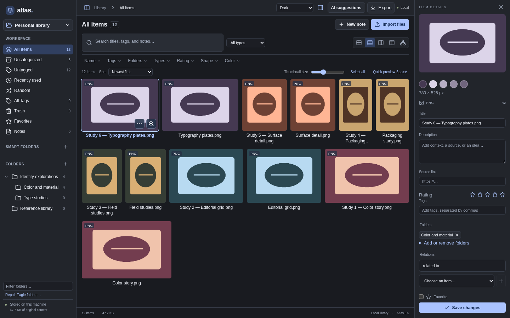
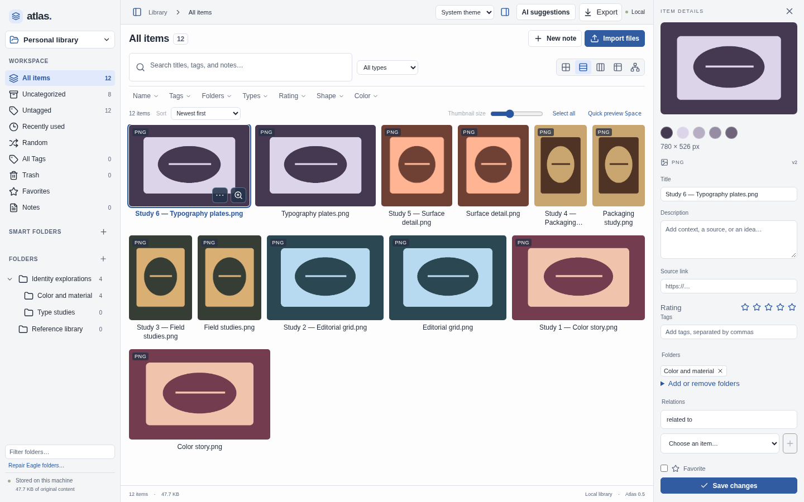
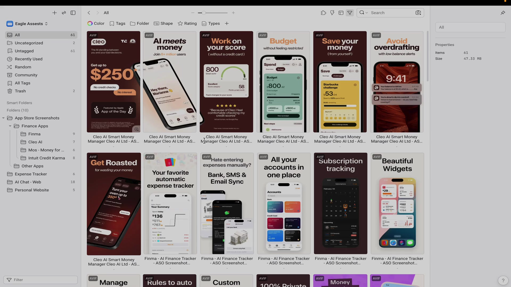

# Atlas design review handoff

Start with the original feedback and the proposed plan. The plan and Eagle reviews are dated snapshots. Use the current implementation status and release notes to confirm what shipped. [Original feedback](ORIGINAL-FEEDBACK.md) · [Review plan](PLAN.md) · [Implementation status](../IMPLEMENTATION_STATUS.md) · [Release notes](../RELEASE_NOTES.md)

## Eagle references
The library-switcher frame has a local storage path redacted.

- The reference index describes the inline screenshots from the original feedback and links to 16 saved frames from the Eagle recording. The walkthrough explains the interactions in time order. [Reference index](references/INDEX.md) · [Recording review](EAGLE_RECORDING_REVIEW.md) · [Saved frames](references/earlier-eagle-recording/)
- The earlier alignment notes record the desktop workflows and storage, export, and MCP questions. The workspace research compares Eagle, Obsidian, and Notion. [Eagle alignment](EAGLE_ALIGNMENT.md) · [Workspace research](../WORKSPACE_RESEARCH.md)
- The extension index covers Eagle’s popup, preferences, batch capture, drag-to-folder overlay, and the prompt shown when the desktop app is closed. The standalone originals of those inline screenshots are available only in the project conversation. [Extension reference index](../EAGLE_EXTENSION_REFERENCES.md)

## Atlas screenshots

| What to review | Image |
|---|---|
| Compact workspace in both themes | [Dark](references/atlas-screenshots/atlas-workspace-dark.png) · [Light](references/atlas-screenshots/atlas-workspace-light.png) |
| Desktop and mobile-sized workspace snapshots | [Desktop](references/atlas-screenshots/atlas-current-desktop.png) · [Mobile-sized view](references/atlas-screenshots/atlas-current-mobile.png) |
| Atlas 0.4 gallery and editor | [Gallery](references/atlas-screenshots/atlas-0.4-gallery.png) · [Note editor](references/atlas-screenshots/atlas-0.4-note.png) |
| Earlier desktop and mobile-sized baseline | [Desktop](references/atlas-screenshots/atlas-desktop.png) · [Mobile-sized view](references/atlas-screenshots/atlas-mobile.png) |

Preview the Atlas workspace and Eagle recording frame

